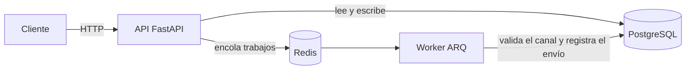

# Take-Home Challenge: API de notificaciones


API REST para crear notificaciones y enviarlas por **email**, **SMS** o **push**. Los envíos se
procesan en segundo plano con una cola de trabajos (ARQ + Redis) y cada intento queda registrado.

## Tabla de contenidos

- [Características](#características)
- [Arquitectura](#arquitectura)
- [Requisitos](#requisitos)
- [Instalación](#instalación)
- [Uso](#uso)
- [API](#api)
- [Tests y calidad de código](#tests-y-calidad-de-código)
- [Decisiones de diseño](#decisiones-de-diseño)
- [Contribuir](#contribuir)
- [Licencia](#licencia)

## Características

- Registro e inicio de sesión con **JWT**; contraseñas con hash **argon2**.
- CRUD de notificaciones por usuario: cada usuario solo ve y modifica las suyas.
- Tres canales con sus propias reglas de validación:
  - `email`: el contenido se escribe en Markdown y se convierte a HTML.
  - `sms`: máximo 160 caracteres y destinatario con formato de celular colombiano
    (`3XXXXXXXXX`, con prefijo opcional `+57`, `57` o `0057`).
  - `push`: máximo 160 caracteres y destinatario con formato de token FCM.
- Envío asíncrono: la API encola un trabajo por destinatario y un worker lo procesa
  (300 s de timeout por trabajo, hasta 10 trabajos concurrentes).
- Historial de envíos con su estado: `success`, `validation_error` o `error`.
- Documentación interactiva con Swagger.

## Arquitectura



El código está organizado por módulos, y cada módulo separa sus capas:

```text
.
├── main.py                 # Punto de entrada de FastAPI
├── src/
│   ├── core/               # Conexión a BD, pool de ARQ, destinatarios de prueba (txt/)
│   ├── modules/
│   │   ├── auth/           # Registro e inicio de sesión
│   │   ├── user/           # Usuarios
│   │   ├── notification/   # CRUD de notificaciones
│   │   └── send/           # Envíos e historial
│   ├── shared/             # Canales, JWT, errores, settings y worker
│   └── scripts/            # Datos de ejemplo (seed)
├── migrations/             # Migraciones de Alembic
└── tests/                  # Tests con pytest y testcontainers
```

Dentro de cada módulo:

| Capa | Responsabilidad |
|---|---|
| `controller/` | Rutas de FastAPI e inyección de dependencias |
| `service/` | Lógica de negocio |
| `infra/` | Modelos SQLAlchemy y repositorios (en `auth`, además, Unit of Work) |
| `schema/` | DTOs (Pydantic), puertos (interfaces) y excepciones |

## Requisitos

- [Docker](https://docs.docker.com/get-docker/) con Docker Compose.
- Opcional, para desarrollar fuera de Docker: Python 3.14 y [uv](https://docs.astral.sh/uv/).

## Instalación

1. Clona el repositorio:

   ```bash
   git clone <url-del-repositorio>
   cd notification-challenge
   ```

2. Crea el archivo de entorno a partir del ejemplo y ajusta los valores:

   ```bash
   cp .env.example .env
   ```

   | Variable | Obligatoria | Descripción |
   |---|---|---|
   | `DB_USER` | Sí | Usuario de Postgres |
   | `DB_PASS` | Sí | Contraseña de Postgres |
   | `DB_NAME` | Sí | Nombre de la base de datos |
   | `SECRET_KEY_JWT` | Sí | Clave para firmar los tokens JWT |
   | `DATABASE_URL` | Sí | URL síncrona (`postgresql+psycopg://...`) |
   | `ASYNC_DATABASE_URL` | Sí | URL asíncrona (`postgresql+asyncpg://...`) |
   | `REDIS_HOST` | No | Host de Redis; por defecto `localhost` |

   Dentro de Docker Compose, `DATABASE_URL`, `ASYNC_DATABASE_URL` y `REDIS_HOST` se generan
   automáticamente para apuntar a los servicios `db` y `redis`.

## Uso

Levanta los servicios, aplica las migraciones y carga los datos de ejemplo:

```bash
./dev.sh up        # API, worker, Postgres y Redis
./dev.sh migrate   # en otra terminal
./dev.sh seed      # opcional: usuarios y notificaciones de prueba
```

La API queda en <http://localhost:8000> y Swagger en <http://localhost:8000/docs>.

### Comandos de `dev.sh`

| Comando | Descripción |
|---|---|
| `up` | Levanta el proyecto (reconstruye si hay cambios) |
| `down` | Detiene y elimina los contenedores |
| `ps` | Muestra el estado de los servicios |
| `logs [svc]` | Sigue los logs de un servicio (por defecto `api`) |
| `build [svc]` | Construye las imágenes |
| `rebuild` | Reconstruye las imágenes sin caché |
| `migrate` | Aplica las migraciones (`alembic upgrade head`) |
| `seed` | Carga los datos de ejemplo |
| `test` | Ejecuta los tests en un contenedor |
| `psql` | Abre una consola de Postgres |
| `shell` | Abre una terminal en el contenedor de la API |
| `reset` | Borra todo, incluidos los datos, y levanta de nuevo |
| `clean` | Elimina contenedores, volúmenes e imágenes del proyecto |

### Datos de ejemplo

`./dev.sh seed` **borra** los usuarios y notificaciones existentes y crea:

| Email | Contraseña |
|---|---|
| `jortiz@mail.com` | `123456` |
| `imunoz@mail.com` | `654231` |
| `jiom@mail.com` | `456789` |

Además, crea 20 notificaciones repartidas al azar entre esos usuarios.

> Estas contraseñas no cumplen la política de `/signup` porque el seed las inserta
> directamente en la base de datos. Sirven para `/signin`, pero no para registrarse.

### Adminer (opcional)

Para inspeccionar la base de datos desde el navegador:

```bash
docker compose --profile adminer up adminer
```

Disponible en <http://127.0.0.1:8080> (servidor: `db`).

### Desarrollo sin Docker

Con Postgres y Redis corriendo en local y el `.env` apuntando a `localhost`:

```bash
uv sync
uv run alembic upgrade head
uv run poe seed users          # opcional: datos de ejemplo
uv run fastapi dev main.py     # API
uv run poe worker              # worker, en otra terminal
```

## API

Todas las rutas, salvo `/signup` y `/signin`, requieren el encabezado
`Authorization: Bearer <token>`.

| Método | Ruta | Descripción |
|---|---|---|
| `POST` | `/signup` | Registra un usuario (form-data: `email`, `password`) |
| `POST` | `/signin` | Inicia sesión (form-data: `username`, `password`) y devuelve `access_token` |
| `GET` | `/notifications` | Lista las notificaciones del usuario |
| `POST` | `/notifications?send=true` | Crea una notificación; con `send=true` además la envía |
| `GET` | `/notifications/{id}` | Obtiene una notificación |
| `PUT` | `/notifications/{id}` | Actualiza una notificación |
| `DELETE` | `/notifications/{id}` | Elimina una notificación |
| `POST` | `/send/{id}` | Encola el envío de una notificación |
| `GET` | `/send` | Historial de envíos del usuario |

La contraseña de `/signup` debe tener al menos 8 caracteres, una minúscula, una mayúscula,
un número y un símbolo (`@$!%*?&`). El título de una notificación debe tener entre 5 y
50 caracteres.

### Códigos de error

Los errores responden con `{"detail": ...}`; los de validación (`422`) incluyen además
una lista `errors` con el campo y el mensaje de cada error.

| Código | Cuándo |
|---|---|
| `401` | Credenciales inválidas o usuario no registrado en `/signin` |
| `403` | Token ausente, inválido o vencido (los tokens duran 60 minutos) |
| `404` | La notificación no existe o pertenece a otro usuario |
| `409` | El email ya está registrado en `/signup` |
| `422` | Error de validación en el cuerpo o los parámetros |
| `503` | Error de infraestructura (por ejemplo, la base de datos no responde) |

### Ejemplo de flujo completo

```bash
# 1. Registro
curl -X POST http://localhost:8000/signup \
  -F email=ana@correo.com -F 'password=Secreta123!'

# 2. Inicio de sesión
TOKEN=$(curl -s -X POST http://localhost:8000/signin \
  -F username=ana@correo.com -F 'password=Secreta123!' | jq -r .access_token)

# 3. Crear una notificación y enviarla
curl -X POST 'http://localhost:8000/notifications?send=true' \
  -H "Authorization: Bearer $TOKEN" \
  -H 'Content-Type: application/json' \
  -d '{"title": "Bienvenida", "content": "# Hola\n\nGracias por registrarte.", "channel": "email"}'

# 4. Ver el historial de envíos
curl http://localhost:8000/send -H "Authorization: Bearer $TOKEN"
```

## Tests y calidad de código

```bash
./dev.sh test          # en Docker
uv run pytest          # en local (necesita Docker y un .env)
uv run poe ruff        # lint
uv run poe ruff:fix    # lint con corrección automática
```

Los tests levantan un Postgres y un Redis temporales con
[testcontainers](https://testcontainers.com/). En local también necesitan el `.env`,
porque la configuración se carga al importar la aplicación. El reporte de cobertura se muestra en la
terminal y se genera en HTML en `htmlcov/index.html`.

## Decisiones de diseño

- **Envíos simulados**: no hay integración con proveedores reales. El "envío" valida el
  contenido y el destinatario según las reglas del canal y registra el resultado en la tabla
  `sends`.
- **Destinatarios de prueba**: se leen de `src/core/txt/{email,sms,push}.txt`, una dirección
  por línea, y se encola un trabajo por cada línea. Todos los destinatarios incluidos son
  válidos, así que el estado `validation_error` aparece cuando falla el contenido (por
  ejemplo, un SMS de más de 160 caracteres) o si se agregan líneas inválidas a esos archivos.
- **Cola de trabajos**: ARQ sobre Redis permite responder rápido al cliente sin bloquear la
  API. Un envío fallido queda registrado con su estado y no se reintenta: ARQ solo reintenta
  (hasta 3 intentos en total) cuando el trabajo supera el timeout o el worker se detiene.
- **Arquitectura por capas con puertos**: los servicios dependen de interfaces
  (`schema/ports.py`), lo que facilita probarlos y cambiar la persistencia.

## Contribuir

1. Crea una rama a partir de `main`.
2. Asegúrate de que `uv run poe ruff` y `uv run pytest` pasen.
3. Usa [Conventional Commits](https://www.conventionalcommits.org/es/) para los mensajes,
   por ejemplo `fix(auth): validar que el usuario exista`.
4. Si cambias modelos, genera la migración con
   `uv run alembic revision --autogenerate -m "descripcion"`.

## Licencia

Proyecto desarrollado como prueba técnica. Sin licencia de uso público.
